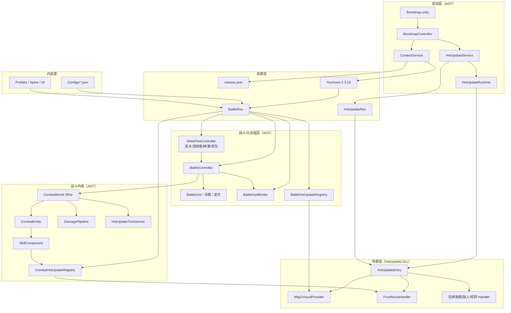

# PrismTactics 架构说明

日期：2026-11-04  
版本：1.2.0  
Unity：2022.3.62f2c1（IL2CPP / Windows Standalone）

## 1. 一句话架构

```text
AOT 主包负责启动、内容加载、战斗框架和热更接口；
BattleRes 负责配置/美术/地图；
HotUpdateRes + HybridCLR 负责可替换的技能、地图表现和后续规则；
release.json 把 BattleRes 与 HotUpdateRes 的版本钉在同一次发布里。
```

## 2. 分层图



## 3. 启动流程

```text
Bootstrap.unity
  → BootstrapController.Start
  → ContentService.LoadAsync
      → 读取 release.json（latest / previous）
      → YooAsset 初始化 BattleRes
      → 预加载全局配置
  → HotUpdateService.LoadAsync
      → 加载 HotUpdateRes 中的 DLL bytes
      → Assembly.Load
      → 反射 IHotUpdateEntry
      → OnRegister 注册地图/技能 Handler
  → 进入 M1_Battle
```

热更失败不会阻塞主流程：

- 找不到 HotUpdateRes：警告并回退 AOT；
- 找不到 Handler：`effectKey` 报错，技能释放失败；
- DLL 加载失败：只影响热更能力，战斗框架仍可运行。

## 4. 战斗 tick

```text
CombatWorld.Update
  → 固定 30Hz 累积
  → TickOnce
      → TargetingService.ScanAll（按间隔）
      → CombatRegistry.TickAll
          → CombatEntity.Tick
              → SkillComponent.Tick
              → AttackCycle.Tick
              → 运行时修饰器/范围覆盖倒计时
      → HotUpdateTickService.Tick
      → Ticked 事件
```

设计取舍：

- 逻辑与渲染分离，固定 tick 保证可复现；
- 技能/DoT/弹幕定时器由 AOT tick 驱动，热更不自己开 Update；
- 伤害统一走 `DamagePipeline`，UI 只监听事件。

## 5. 资源与发布

```text
Assets/GameContent
  ├── Configs/        → BattleRes
  ├── UIPrefab/
  ├── UIHandDrawn/
  ├── MapVisual/
  └── ...
Assets/HotUpdate/     → PrismTactics.HotUpdate.dll
Assets/HotUpdateRes/  → DLL bytes → HotUpdateRes
```

发布顺序：

```text
1. Generate/All（HybridCLR）
2. 复制 HotUpdate DLL → HotUpdateRes/*.bytes
3. 构建 HotUpdateRes
4. 构建 BattleRes
5. 写 release.json（latest / previous）
6. 构建 Player
```

回滚：

```text
release.json.latest = previous
→ 重新进入 Boot
→ 加载上一版 BattleRes / HotUpdateRes
```

内置目录会合并所有版本的 bundle 映射，避免旧 manifest 因 Catalog 缺 GUID 而失败。

## 6. 热更扩展点

| 扩展点 | AOT 接口 | 热更实现 |
|---|---|---|
| 地图视觉 | `IMapVisualProvider` | `Map2VisualProvider` |
| 技能效果 | `ISkillEffectHandler` / `ISkillEffectContext` | `FrostNovaHandler` |
| 定时器 | `HotUpdateTickService` | DoT、延迟、弹幕移动 |
| 视觉生成 | `IHotUpdateVisualService` | 子弹/爆炸/预警 |
| 运行时修改 | `SetRangeOverride` / `AddTimedAttackSpeed` / `AddStatModifier` | 开关型技能 |

原则：

```text
AOT 提供能力原语和生命周期；
热更只做组合和策略；
不把新 MonoBehaviour 序列化进场景/Prefab。
```

## 7. 关键代码索引

| 模块 | 路径 |
|---|---|
| 启动/内容 | `Assets/_Project/Scripts/Battle/Runtime/Content/` |
| 热更服务 | `Assets/_Project/Scripts/Launcher/Runtime/` |
| 战斗内核 | `Assets/_Project/Scripts/Combat/Runtime/` |
| 战斗流程 | `Assets/_Project/Scripts/Battle/Runtime/` |
| 热更代码 | `Assets/HotUpdate/` |
| 构建工具 | `Assets/_Project/Scripts/Combat/Editor/Phase3*` |
| 测试 | `Assets/_Project/Scripts/Tests/` |
