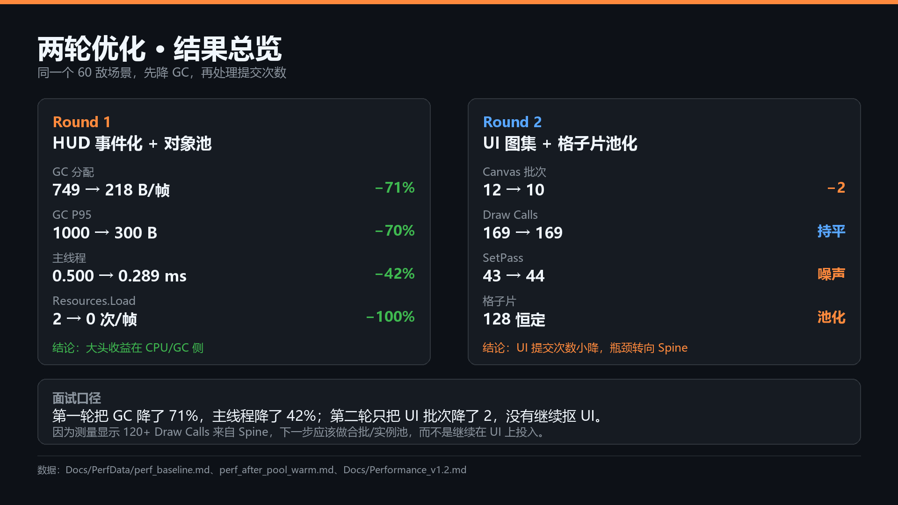

# PrismTactics

一个 Unity 2D 塔防战斗模块作品集：固定 30Hz 逻辑帧、数据驱动内容、编辑器工具链、YooAsset + HybridCLR 版本热更，以及 60 敌同屏性能优化。

项目目标不是做完整商业游戏，而是把「战斗框架 + 工具链 + 工程化证据」做扎实，便于展示设计取舍和落地能力。



## 概览

- 5 名干员、10 个技能、5 类敌人、6 个关卡、2 张地图
- 选关 → 选技能 → 战斗 → 结算 → 掉落 → 背包
- 固定 30Hz 逻辑帧，渲染与逻辑解耦
- 干员/敌人/技能/关卡/地图/波次均为 JSON 配置驱动
- AOT 主包 + HybridCLR 热更程序集 + YooAsset 资源版本
- 角色/技能/敌人/地图编辑器，配置校验器，一键构建/发布/替换工具
- 60 敌峰值场景性能基线、Profiler 采样报告与优化记录

## 技术栈

| 项 | 版本/方案 |
|---|---|
| Unity | 2022.3.62f2c1 |
| 脚本后端 | IL2CPP |
| 资源 | YooAsset 2.3.19，BattleRes / HotUpdateRes 双包 |
| 热更 | HybridCLR 9.0.3 |
| 战斗逻辑 | 固定 30Hz tick |
| 渲染 | 内置管线，2D Sprite / Spine |
| 测试 | Unity Test Framework，EditMode + PlayMode |

## 模块

### 战斗框架

- `CombatWorld`：固定 tick 驱动、实体注册、索敌、伤害结算
- `CombatEntity` / `AttackCycle`：前摇、命中、后摇、阻挡、目标选择
- `BattleGrid` / `GridPathfinder`：格子占用、范围、寻路与阻挡索引
- `WaveManager` / `EnemyUnit`：波次、出怪、移动、漏怪
- `BattleController`：生命、费用、部署、胜负、战斗事件

### 技能与 Meta 流程

- `SkillComponent`：SP 回复、手动/自动触发、持续 Buff、治疗
- `HotUpdateSkillApi`：AOT 与热更技能处理器之间的接口
- `MetaFlowController`：选关、选技能、战斗、结算、掉落、背包
- `UIManager` / `PanelBase`：面板生命周期与统一管理

### 编辑器工具

菜单入口：`Tools/PrismTactics`

- `1.1.1` 角色编辑器：属性、部署规则、攻击范围、技能槽
- `1.1.2` 技能编辑器：SP、效果、范围、数值预览
- `1.2.1` 怪物编辑器
- `1.2.2` 地图编辑器：地形、可部署、基地/出生点、路线、波次
- `1.3.1` 配置校验：ID 重复、字段越界、资源路径、引用完整性
- `2.1` / `2.2` / `2.3`：HybridCLR、热更包、内容包、版本清单、Player 构建与替换

## 性能优化

测试场景：`Assets/_Project/Scenes/M1_Perf60.unity`  
口径：60 敌同屏，取同屏 ≥ 峰值 80% 的 358 帧峰值窗口，Windows Editor；Player 数据另列。

### 第一轮：HUD 事件化 + 对象池预热

问题：`BattleHudBinder.Update` 每帧拼字符串、每帧 `Resources.Load` 头像/技能图标、遍历干员 `GetComponent`，HUD 每帧约 0.7 KB、23 次 `GC.Alloc`。

改动：

- 生命、费用、敌人数量、选中变化改为事件驱动
- 值不变不刷新，属性/生命/SP 拆分更新
- 头像、技能图标缓存
- 血条、弹道、伤害数字对象池预热
- 路线缓存

结果：

| 指标 | 优化前 | 优化后 | 变化 |
|---|---:|---:|---:|
| GC 分配 | 748.9 B/帧 | 218.2 B/帧 | −71% |
| GC P95 | 1000 B | 300 B | −70% |
| 主线程帧时间 | 0.500 ms | 0.289 ms | −42% |
| 主线程 P95 | 0.840 ms | 0.459 ms | −45% |
| `Resources.Load` | 2.00 次/帧 | 0.00 次/帧 | −100% |

> 218 B/帧 是 HUD 事件化 + 对象池预热后的最终值；HUD 事件化刚完成时的中间值为 244 B/帧。

### 第二轮：UI 图集 + 格子片池化

改动：

- 35 个 UI 小图 + 5 张裁切立绘收进 2048 BC7 SpriteAtlas
- `UiAtlasService` 统一从图集取图，未命中回退单图
- 拖拽范围/高亮格子片改为 128 个预热对象、2 套共享材质

结果：

| 指标 | 优化前 | 优化后 | 变化 |
|---|---:|---:|---:|
| Canvas 批次（UI） | 12 | 10 | −2 |
| Draw Calls（整帧） | 169 | 169 | 噪声内 |
| SetPass Calls | 43 | 44 | 噪声内 |

整帧 Draw Calls 没有明显下降，因为 60 个 Spine 单位贡献 120+ Draw Calls，UI 只占约 6%。这一轮的目标是 UI 提交次数和拖拽一次性开销，不是帧率或 CPU。

详细数据与口径：

- [Performance_v1.1.md](Docs/Performance_v1.1.md)
- [Performance_v1.2.md](Docs/Performance_v1.2.md)
- [PerfData](Docs/PerfData)
- [PerfScreenshots](Docs/PerfScreenshots)

## 热更与版本

资源与代码分两层：

```text
AOT 主包
  ├─ 战斗框架、启动流程、UI 框架
  ├─ BattleRes：配置、UI、地图、单位、战斗表现
  └─ HotUpdateRes：HotUpdate DLL 的原始 bytes

release.json
  ├─ latest / previous
  └─ 每个 release 绑定 battleResVersion + hotUpdateResVersion
```

- 主包只依赖 `IHotUpdateEntry` 接口，不直接引用热更程序集
- 热更 DLL 以 `.bytes` 形式作为 TextAsset 打包，运行时由 HybridCLR 加载
- `release.json` 统一切换 BattleRes 与 HotUpdateRes 版本
- 1.0 内容：4 干员 / 5 关；1.2 内容：5 干员 / 6 关
- 演示链路：1.0 Player → 构建 1.2 热更包/内容包 → 一键替换 → 1.2 生效 → 改回 1.0 回滚
- 录制环境使用内置包 + `StreamingAssets` 替换模拟热更，不依赖真实 CDN

详见 [M3.3_HotUpdate.md](Docs/M3.3_HotUpdate.md) 与 [M3.2_Release.md](Docs/M3.2_Release.md)。

## 目录

```text
Assets/
  _Project/
    Scenes/          Bootstrap / M1_Battle / M1_Perf60
    Scripts/
      Combat/        战斗内核、技能、编辑器工具
      Battle/        战斗流程、UI、地图、内容加载
      Launcher/      启动、YooAsset、HybridCLR
      HotUpdate/     热更程序集
  GameContent/
    Configs/         关卡、地图、波次、干员、敌人、技能
    UIPrefab/        HUD 与 Meta 面板
    UIHandDrawn/     UI 图与图集
  StreamingAssets/   OfflinePlayMode 内置资源
Docs/                架构、发布、热更、性能与工具文档
```

## 运行

1. 使用 Unity `2022.3.62f2c1` 打开项目。
2. 打开 `Assets/_Project/Scenes/Bootstrap.unity`。
3. 点击 Play，等待内容加载后进入 `M1_Battle`。

直接 Play `M1_Battle` / `M1_Perf60` 会提示“内容尚未加载”，这是预期行为；应从 Bootstrap 或测试入口加载内容。

构建入口：

```text
Tools/PrismTactics/2 构建与热更
```

## 文档

- [架构说明](Docs/Architecture.md)
- [性能基线与优化](Docs/Performance_v1.1.md)
- [性能报告 v1.2](Docs/Performance_v1.2.md)
- [性能采样方法](Docs/Perf_HowTo_v1.2.md)
- [M3.0 验证记录](Docs/M3.0_Verification.md)
- [M3.1 配置迁移](Docs/M3.1_Configs.md)
- [M3.1 资源迁移](Docs/M3.1_ResourceMigration.md)
- [M3.2 发布清单与回滚](Docs/M3.2_Release.md)
- [M3.3 热更](Docs/M3.3_HotUpdate.md)
- [UI 图集](Docs/UiAtlas_v1.2.md)
- [配置与 DLC](Docs/DLC_Incremental.md)
- [第三阶段设计](Docs/Phase3_Plan.md)

## 说明

- 本项目为个人学习与作品展示，不含商业发行内容。
- Spine 运行时、DOTween 及其他第三方资源的版权归原作者所有；使用前请确认对应许可。
- 仓库中的性能数字均标注了场景、采样窗口和平台口径；跨版本只比较同口径数据。
